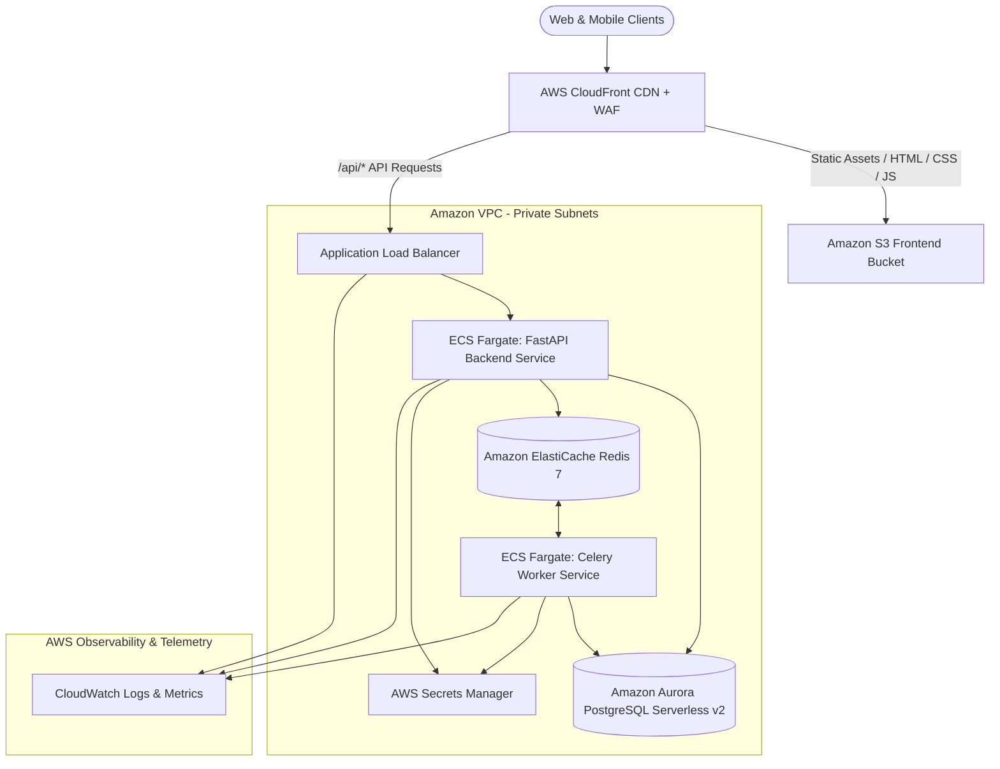

# AWS Production Cloud Deployment Blueprint

**Platform:** AI Stock Market Assistant  
**Target Architecture:** Multi-tier AWS Cloud Native (ECS Fargate + Aurora Serverless v2 + ElastiCache + S3/CloudFront)  
**Security Standard:** Zero-Trust, AWS Secrets Manager, IAM Least Privilege, Encrypted-at-Rest & In-Transit  

---

## 1. High-Level AWS Architecture Diagram



---

## 2. Infrastructure Components & Specifications

### 2.1. Frontend Hosting: Amazon S3 & CloudFront CDN
- **Origin:** Private Amazon S3 bucket configured with Origin Access Control (OAC). Public bucket access blocked.
- **Distribution:** Amazon CloudFront distribution terminating TLS 1.3 with AWS Certificate Manager (ACM) free wildcard certificate (`*.yourdomain.com`).
- **Edge Caching:**
  - Static hashed assets (`/assets/*.js`, `/assets/*.css`): 1-year cache with immutable headers.
  - HTML entrypoint (`index.html`): `Cache-Control: no-cache, no-store, must-revalidate`.
- **WAF Rules:** Rate limiting (2,000 requests per 5 minutes per IP), Common Rule Set (CRS), and Known Bad Inputs protection.

### 2.2. Application Server: Amazon ECS on AWS Fargate
- **Backend Service:**
  - Container Image: Built from `docker/Dockerfile.backend`.
  - Task Definition: 1.0 vCPU, 2.0 GB Memory per task.
  - Autoscaling: Min 2 tasks, max 10 tasks based on CPU utilization > 70% or ALB Request Count Target.
  - Network: Private application subnets across 2 Availability Zones (AZs).
- **Celery Worker Service:**
  - Container Image: Built from `docker/Dockerfile.backend`, command overridden to Celery worker.
  - Task Definition: 1.0 vCPU, 2.0 GB Memory.
  - Autoscaling: Based on Redis queue length (`ApproximateNumberOfMessages`).

### 2.3. Managed Databases & State Stores
- **Primary Relational Database: Amazon Aurora PostgreSQL Serverless v2**
  - Engine Version: PostgreSQL 16.
  - Capacity: Scalable from 0.5 ACU (1 GB RAM) to 8.0 ACU (16 GB RAM).
  - High Availability: Multi-AZ automated failover with read replicas.
  - Storage Encryption: AES-256 with AWS KMS customer-managed key.
- **In-Memory Cache & Message Broker: Amazon ElastiCache for Redis**
  - Engine: Redis 7.x cluster mode disabled with 1 primary and 1 replica node in separate AZs.
  - Node Type: `cache.t4g.medium` (Graviton2 ARM64).
  - In-transit and At-rest encryption enabled with AUTH password managed in Secrets Manager.

### 2.4. Credential Management: AWS Secrets Manager
All provider credentials are stored in an encrypted JSON secret `prod/stock-assistant/credentials`:
```json
{
  "ALPHA_VANTAGE_API_KEY": "...",
  "TWELVE_DATA_API_KEY": "...",
  "FMP_API_KEY": "...",
  "NEWSAPI_API_KEY": "...",
  "NASDAQ_DATA_LINK_API_KEY": "...",
  "DATABASE_URL": "postgresql+asyncpg://...",
  "REDIS_URL": "rediss://..."
}
```
ECS task execution roles fetch secrets directly at container initialization via IAM task execution role policy `secretsmanager:GetSecretValue`.

---

## 3. Production Deployment Step-by-Step

### Step 1: ECR Image Build and Push
```bash
# Authenticate Docker to AWS ECR
aws ecr get-login-password --region us-east-1 | docker login --username AWS --password-stdin <ACCOUNT_ID>.dkr.ecr.us-east-1.amazonaws.com

# Build and push Backend image
docker build -t fintech-assistant-backend:latest -f docker/Dockerfile.backend .
docker tag fintech-assistant-backend:latest <ACCOUNT_ID>.dkr.ecr.us-east-1.amazonaws.com/fintech-assistant-backend:latest
docker push <ACCOUNT_ID>.dkr.ecr.us-east-1.amazonaws.com/fintech-assistant-backend:latest
```

### Step 2: Frontend Build and S3 Sync
```bash
cd src/frontend
npm ci
npm run build

# Sync built assets to S3
aws s3 sync dist/ s3://fintech-assistant-frontend-prod --delete

# Invalidate CloudFront distribution
aws cloudfront create-invalidation --distribution-id <DISTRIBUTION_ID> --paths "/*"
```

### Step 3: Run Database Migrations
```bash
aws ecs run-task \
  --cluster fintech-production-cluster \
  --task-definition fintech-migration-task \
  --launch-type FARGATE \
  --network-configuration "awsvpcConfiguration={subnets=[<SUBNET_1>,<SUBNET_2>],securityGroups=[<APP_SG>],assignPublicIp=DISABLED}"
```

### Step 4: ECS Service Rolling Update
```bash
aws ecs update-service \
  --cluster fintech-production-cluster \
  --service fintech-api-service \
  --force-new-deployment
```

---

## 4. Cost Optimization & Monitoring Strategy

- **Idle Scaling:** Aurora Serverless v2 scales down to 0.5 ACU during non-market hours (weekends and nights), reducing database spend by up to 75%.
- **Spot Fargate for Workers:** Asynchronous Celery worker tasks can run on AWS Fargate Spot for up to 70% cost savings compared to on-demand Fargate.
- **CloudWatch Synthetic Canary:** Heartbeat probe hits `/health` and `/api/v1/market/quote?symbol=NVDA` every 60 seconds from multiple AWS regions, alarming to PagerDuty/Slack if latency > 1,500ms or HTTP status != 200.
