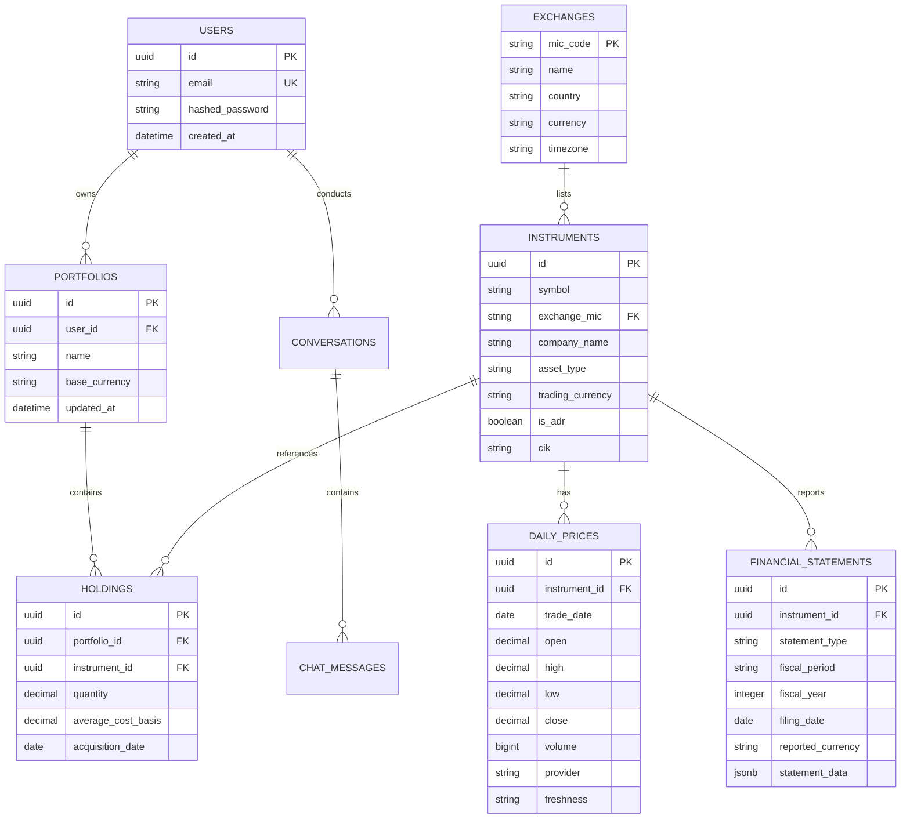
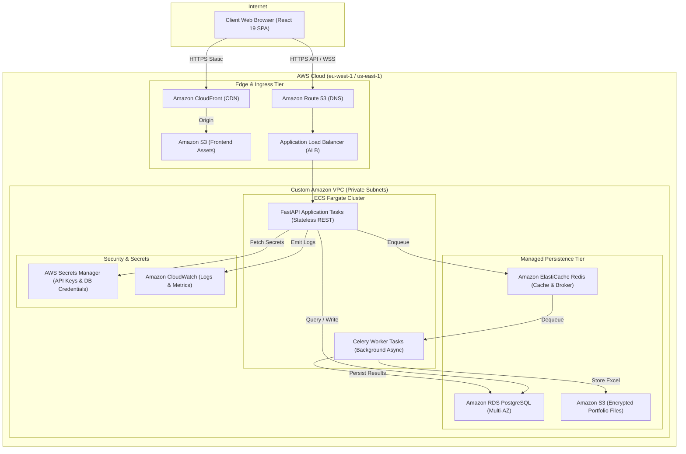
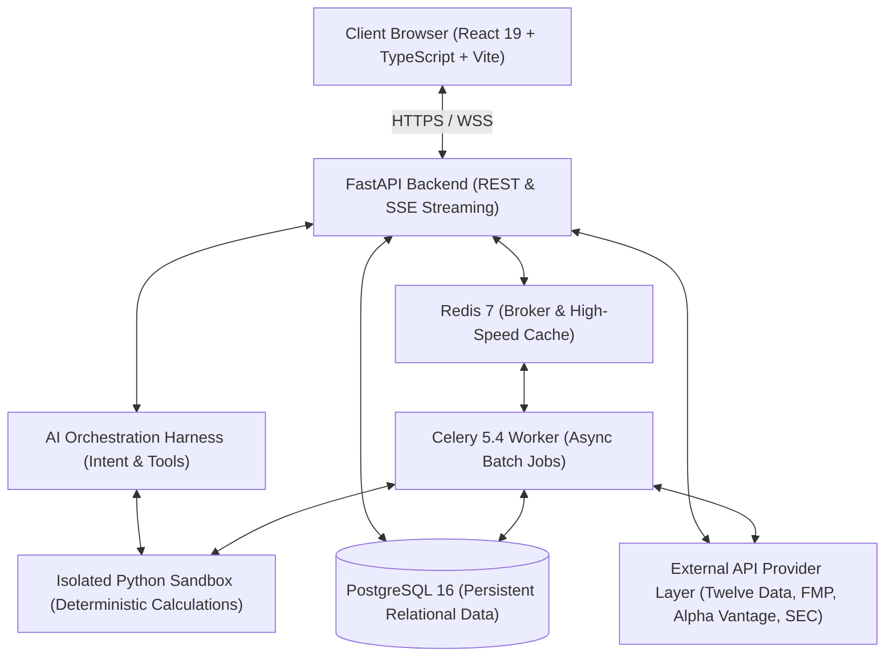
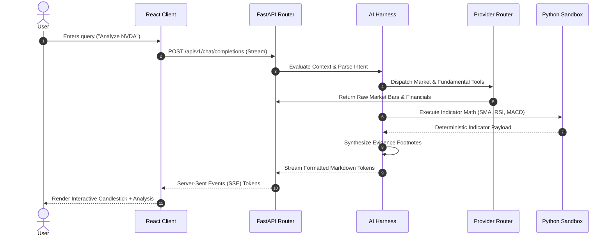
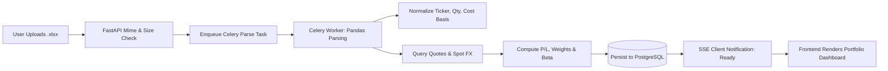

# AI Stock Market Assistant — Master Consolidated Project Specification

**Document Version:** 1.0.0-PROD-SPEC  
**Status:** Single Source of Truth for Architecture & Implementation  
**Working Directory:** `E:\finTech-inkVector`  
**Specification Location:** `E:\finTech-inkVector\docs\PROJECT_SPECIFICATION.md`  
**Date:** 2026-11-11  
**Author:** Principal Software Architect, AI Systems Architect, Financial Data Engineer, Frontend UI/UX Architect, and Security Specialist  

---

## Decision Classification Legend
Every technical, architectural, product, and infrastructure decision throughout this specification is explicitly marked using the following standardized taxonomy:
- `[CONFIRMED]`: Empirically verified via live tests, established codebase artifacts, or validated provider constraints. Non-negotiable baseline.
- `[RECOMMENDED]`: Evidence-based architectural selection backed by empirical benchmark or ecosystem audit. Default implementation path.
- `[PROVISIONAL]`: Functional interim design enabling initial delivery; subject to review following production load or licensing transitions.
- `[UNRESOLVED]`: Known open constraint requiring upstream provider resolution, legal sign-off, or budget commitment before completion.
- `[FUTURE ENHANCEMENT]`: Deliberately deferred feature earmarked for post-v1.0 milestone; must not block core implementation.

---

# 1. Executive Summary

The **AI Stock Market Assistant** is a unified, institutional-grade financial research, quantitative stock analysis, and portfolio intelligence platform. Designed to bridge the gap between retail investor accessibility and institutional portfolio rigor, the platform delivers an intelligent conversational interface coupled with high-density, interactive financial dashboards.

Unlike superficial chatbots that generate plausible-sounding but unverified financial claims, this assistant functions strictly as an **evidence-based financial research assistant**. Every numeric calculation (technical indicators, portfolio returns, currency conversions, scenario valuations) is executed deterministically by a secure, isolated Python analytical sandbox. Every fundamental statement and corporate disclosure is retrieved directly from official regulatory repositories (SEC EDGAR) or verified normalized APIs (Financial Modeling Prep `/stable/`). Every market price tick and historical bar is ingested with strict source attribution, explicit freshness classification, and non-negotiable currency demarcation.

The platform is designed for cloud-native scalability on Amazon Web Services (AWS), with an initial local-development footprint prioritized for rapid iteration, deterministic testing, and zero initial cloud spend.

---

# 2. Product Vision

The platform brings together fourteen discrete capabilities into a cohesive, synchronized research experience:
1. **Global Equity Market Ingestion:** US markets, UK (LSE), and international proxy coverage via American Depositary Receipts (ADRs).
2. **Deterministic Technical Analysis:** Mathematical indicator calculation (SMA, EMA, RSI, MACD, Bollinger Bands, ATR) powered by Python.
3. **Audited Fundamental Analysis:** Multi-period balance sheets, income statements, and cash flows with GAAP/IFRS XBRL fact preservation.
4. **Contextual Financial News & Sentiment:** Publisher-attributed, timestamped news aggregation with NLP-driven sentiment tagging.
5. **Excel Portfolio Ingestion & Analytics:** Dynamic spreadsheet upload, fuzzy column mapping, currency-adjusted returns, and sector exposure breakdown.
6. **Hypothetical Scenarios & What-If Simulations:** Capital re-allocation modeling, stress testing (-10% shocks, FX swings), and historical backtesting.
7. **Institutional Research Reporting:** Markdown-based, citation-backed company profiles, multi-ticker comparison matrices, and executive summaries.
8. **Interactive Dual-Engine Visualizations:** High-performance HTML5 Canvas trading charts for price action; SVG declarative charts for portfolio allocations.
9. **Asynchronous Background Processing:** Worker-driven execution for compute-heavy multi-asset scans, filings extraction, and batch jobs.
10. **Audit Trail & Analysis History:** Immutable persistence of all user queries, tool invocations, intermediate payloads, and generated insights.
11. **Provider Abstraction Architecture:** Decoupled data contracts ensuring the application is never held hostage by a single vendor's API or pricing shift.
12. **Defensive Sandbox Architecture:** Genuinely isolated execution environment for untrusted analytical routines with memory, CPU, and network controls.
13. **Strict Non-Execution Brokerage Boundary:** A research platform exclusively—zero automated trading, zero brokerage API write tokens, zero order execution.
14. **Production Cloud Readiness:** Architected from day one for seamless containerization and deployment onto AWS ECS Fargate, RDS PostgreSQL, and ElastiCache.

---

# 3. Target Users & Personas

The application serves two distinct user personas through one adaptive interface:

```
+---------------------------------------------------------------------------------------------------+
|                                      TARGET USER PERSONAS                                         |
+--------------------------+------------------------------------+-----------------------------------+
| Attribute                | Persona A: Individual Retail       | Persona B: Professional Portfolio  |
|                          | Self-Directed Investor             | Manager / Research Analyst        |
+--------------------------+------------------------------------+-----------------------------------+
| **Primary Goal**         | High-conviction idea validation,   | Multi-asset valuation modeling,    |
|                          | portfolio health checks, news.     | risk attribution, filing audits.  |
| **Interaction Mode**     | Natural language conversational    | Structured tabular views, multi-  |
|                          | prompts, visual summary cards.     | ticker overlays, raw XBRL facts.  |
| **Key Workflows**        | "Analyze NVDA", Excel portfolio    | Cross-sectional P/E vs growth,    |
|                          | upload, "What if TSLA drops 10%?"  | 10-K risk factor extraction, FX.  |
| **Financial Literacy**   | Intermediate; seeks clear plain-   | Advanced; requires raw numbers,   |
|                          | English indicator explanations.    | reporting periods, accounting tag.|
| **Key Frustrations**     | Hallucinated AI metrics, complex   | Rigid dashboards, delayed filings,|
|                          | disjointed tools, opaque fees.     | black-box quantitative models.    |
+--------------------------+------------------------------------+-----------------------------------+
```

---

# 4. User Journeys & Core Workflows

### Journey 1: Natural-Language Single-Stock Research
1. User enters: *"Perform a complete technical and fundamental review of NVIDIA."*
2. **Intent Parser:** Resolves intent `ANALYZE_STOCK_COMPREHENSIVE`, extracts entity `NVIDIA`.
3. **Symbol Resolution:** Identifies `NVDA` on `NASDAQ` (Currency: `USD`).
4. **Parallel Data Ingestion:**
   - Dispatches Twelve Data adapter for daily OHLCV bars (Latest 100 days).
   - Dispatches FMP `/stable/` adapter for 3-statement financial statements and profile.
   - Dispatches SEC EDGAR adapter for latest Form 10-Q filing metadata.
   - Dispatches NewsAPI adapter for recent company headlines.
5. **Python Analytics Engine:** Calculates 50-day/200-day SMA, 14-day RSI (determines overbought/oversold status), and MACD histogram.
6. **Response Generation:** Renders an interactive Canvas candlestick chart with volume, a key financial metrics grid, a concise news sentiment card, and a plain-English executive summary.
7. **Provenance Display:** Renders explicit data freshness tags (`Delayed 15-min`, `Source: Twelve Data`, `Filing Date: 2026-02-25`).

### Journey 2: Excel Portfolio Ingestion & Risk Diagnostics
1. User navigates to the Portfolio workspace and uploads `my_portfolio.xlsx`.
2. **File Processing Pipeline:** FastAPI backend validates MIME type, scans for macro threats, passes bytes to Python pandas parsing service.
3. **Column Reconciliation:** Normalizes columns (resolves `Ticker` -> `symbol`, `Shares` -> `quantity`, `Cost Basis` -> `purchase_price`, `Currency` -> `currency`). Reports any ambiguous rows to user.
4. **Market Valuation & FX Translation:** Asynchronous Celery task queries Twelve Data and Alpha Vantage for current market quotes; queries FX rates to normalize all holdings into the user's base portfolio currency (e.g., `USD`).
5. **Risk & Exposure Calculation:** Computes total invested capital, current market value, unrealized P/L ($ and %), portfolio beta, Herfindahl-Hirschman concentration index, and currency exposure breakdown.
6. **Interactive Dashboard:** Presents an interactive SVG Donut allocation chart, an asset performance waterfall, and conversational suggested follow-ups (*"Your portfolio has 42% exposure to US Tech. Would you like to model a 15% defensive rotation?"*).

### Journey 3: Hypothetical Allocation & What-If Stress Testing
1. User prompts: *"How would allocating $25,000 across NVDA, MSFT, and HSBC affect my overall risk if European markets drop 8%?"*
2. **Scenario Engine:** Pulls current volatility parameters, historical correlations, and current holding weights.
3. **Sandbox Execution:** Executes mathematical stress-testing routine inside the isolated Python sandbox.
4. **Output Rendering:** Displays side-by-side comparative table:
   - Baseline Portfolio vs. Hypothetical Portfolio.
   - Projected P/L impact under the -8% European shock.
   - Distinct, unmissable alert: `[HYPOTHETICAL SIMULATION - NOT BROKERAGE ADVICE]`.

---

# 5. Complete Functional Requirements

```
+---------------------------------------------------------------------------------------------------+
|                                 FUNCTIONAL REQUIREMENTS MATRIX                                    |
+--------+----------------------------+-------------------------------------------------------------+
| ID     | Module                     | Detailed Functional Capability                              |
+--------+----------------------------+-------------------------------------------------------------+
| **F01**| Conversational Engine      | Multi-turn financial chat with context memory & slot-filling|
| **F02**| Instrument Normalizer      | Ticker, exchange, MIC, currency, and ADR disambiguation    |
| **F03**| Market Data Ingestion      | Ingestion of EOD, delayed, and real-time OHLCV bars & quotes|
| **F04**| Technical Analysis         | Deterministic calculation of SMA, EMA, RSI, MACD, ATR, Vol  |
| **F05**| Fundamental Analysis       | Multi-period Balance Sheet, Income, and Cash Flow extraction|
| **F06**| Regulatory Filing Search   | SEC EDGAR 10-K, 10-Q, 8-K, 20-F, and 6-K submission queries |
| **F07**| News & Sentiment Tracking  | Multi-topic financial headline retrieval with sentiment tags|
| **F08**| Spreadsheet Integration    | Excel (.xlsx, .xls) and CSV upload with fuzzy column mapping|
| **F09**| Portfolio Analytics        | Realized/unrealized P/L, concentration, currency exposure   |
| **F10**| What-If & Scenario Engine  | Mathematical simulations of reallocations and price shocks  |
| **F11**| Dynamic Chart Rendering    | Canvas candlestick charts + SVG allocation and metrics visual|
| **F12**| Asynchronous Job Manager   | Celery worker lifecycle tracking with polling & notifications|
| **F13**| Audit Logging & Provenance | Immutable tracking of data sources, timestamps, and queries |
+--------+----------------------------+-------------------------------------------------------------+
```

---

# 6. Complete Non-Functional Requirements

### 6.1 Performance & Latency
- **Conversational Streaming:** Time-to-First-Token (TTFT) for conversational responses under 800ms.
- **REST API Response Time:** Cached financial market quotes and profile responses returned under 150ms (p95).
- **Asynchronous Task Dispatch:** Long-running analytical workflows acknowledged with a `job_id` under 50ms.
- **Client Chart Rendering:** Initial render of 500 daily candlestick bars under 60ms on desktop; smooth 60fps canvas panning and zooming.

### 6.2 Availability & Resilience
- **Stateless Backend Tier:** FastAPI application nodes must remain strictly stateless to permit dynamic horizontal auto-scaling.
- **Circuit Breakers & Provider Failover:** Automatic fallback between Twelve Data and FMP upon receipt of HTTP 429, 500, or network timeouts.
- **Graceful Degradation:** In the event of a provider outage, the system serves cached data marked with explicit staleness warnings.

### 6.3 Security & Zero Credential Exposure
- **Zero Token Leakage:** Absolute prohibition on API keys or sensitive authorization tokens appearing in client code, URLs, logs, or error responses.
- **Encrypted Persistence:** All database columns storing sensitive portfolio configurations or user session tokens encrypted at rest via AES-256.
- **Strict Network Sandbox:** The Python analytical sandbox must operate without external outbound network access (`--network none`).

### 6.4 Data Precision & Accuracy
- **Zero Floating-Point Artifacts:** All monetary calculations, currency conversions, and share balances must use arbitrary-precision `Decimal` types (`decimal.Decimal` in Python; `bignumber.js` or numeric string representations on the frontend). Standard binary floating-point (`float` / `double`) is strictly banned for currency.

---

# 7. Global Financial Data & Market Handling

Financial markets cannot be treated as a single uniform timezone or currency domain:

```
                               GLOBAL INSTRUMENT AMBIGUITY RESOLUTION
                               
                               User inputs: "Show Toyota stock"
                                              │
                         ┌────────────────────┴────────────────────┐
                         ▼                                         ▼
            [Primary Domestic Listing]                  [Foreign Depository Receipt]
            Instrument: Toyota Motor Corp               Instrument: Toyota Motor Corp ADR
            Exchange: Tokyo Stock Exchange (TSE/JPX)    Exchange: New York Stock Exchange (NYSE)
            Ticker: 7203                                Ticker: TM
            Trading Currency: JPY                       Trading Currency: USD
            Settlement: T+2 (JST)                       Settlement: T+1 (EST)
            Provider Entitlement: Paywalled             Provider Entitlement: Free Tier Verified
                         │                                         │
                         ▼                                         ▼
           [System Prompt Clarification]: "Toyota trades natively as 7203 on Tokyo Stock Exchange (JPY),
            and as an ADR (TM) on NYSE (USD). Free-tier live data is currently available for TM (USD).
            Which listing would you like to analyze?"
```

### 7.1 Cross-Border Currency Conversion Rules
- **No Implicit Aggregation:** Summing assets denominated in different currencies (e.g. 100 shares of `NVDA` in USD + 500 shares of `HSBA` in GBp) without active FX normalization is strictly prohibited.
- **Historical FX Matching:** Portfolio performance calculations must apply historical exchange rates corresponding to the exact transaction dates, rather than multiplying historical cost basis by today's spot rate.
- **Base Currency Declaration:** Every portfolio instance must declare an explicit base reporting currency (`USD`, `EUR`, `GBP`, `JPY`, or `CHF`).

### 7.2 Exchange Calendars & Trading Sessions
- The system must track exchange operating hours and regional holidays:
  - **US (NYSE / NASDAQ):** 09:30 – 16:00 EST; Eastern Timezone.
  - **UK (LSE):** 08:00 – 16:30 GMT; London Timezone.
  - **Japan (TSE):** 09:00 – 11:30, 12:30 – 15:30 JST; Tokyo Timezone.
  - **Switzerland (SIX):** 09:00 – 17:30 CET; Zurich Timezone.
- Quotes retrieved outside active market sessions must be explicitly labeled `Market Closed - Previous Close`.

---

# 8. Data Architecture & Provenance Tracking

Every financial datum persisted or transmitted within the application must conform to the **Unified Data Provenance Schema**:

```python
class DataFreshnessType(str, Enum):
    REAL_TIME = "REAL_TIME"       # Direct exchange stream or low-latency tick (<15s)
    DELAYED = "DELAYED"           # Standard exchange delayed feed (typically 15-20 min)
    END_OF_DAY = "END_OF_DAY"     # Official settled daily closing bar
    HISTORICAL = "HISTORICAL"     # Archived historical bar or past filing period

class FinancialRecordProvenance(BaseModel):
    instrument_id: str            # Global internal UUID
    symbol: str                   # Ticker symbol
    exchange_mic: str             # ISO 10383 Market Identifier Code (e.g. XNGS, XLON)
    currency: str                 # ISO 4217 Currency Code (e.g. USD, GBp, JPY)
    provider_name: str            # Source provider (twelve_data, fmp, alpha_vantage, sec_edgar)
    freshness: DataFreshnessType  # Freshness classification
    as_of_timestamp: datetime     # Timestamp when data was generated/settled in market
    retrieved_at: datetime        # Timestamp when our backend ingested the data
    data_quality_score: float     # Validation confidence (1.0 = fully verified)
```

---

# 9. Provider Research & Empirical Validation Findings

The architecture incorporates empirical test findings across 57 validated test requests:

```
+---------------------------------------------------------------------------------------------------------------+
|                                      FINAL AUDITED PROVIDER MATRIX                                            |
+----------------------+--------------------+---------------------+---------------------------------------------+
| Provider             | Status             | Tested Coverage     | Entitlement & Operational Constraints       |
+----------------------+--------------------+---------------------+---------------------------------------------+
| **Twelve Data**      | Confirmed Primary  | US Equities (NVDA)  | Free tier strictly limits to US equities.   |
|                      |                    | Global Symbol Search| Non-US time series require Grow ($79/mo)    |
|                      |                    |                     | or Pro ($229/mo). 800 req/day cap.          |
+----------------------+--------------------+---------------------+---------------------------------------------+
| **Financial Modeling | Confirmed Primary  | US Equities (NVDA)  | Keys post-Aug 31, 2025 mandate /stable/.    |
| Prep (FMP)**         | (Fundamentals)     | US ADRs (HSBC, TM)  | Direct foreign listings (.L, .T) locked.    |
|                      |                    | 3-Statement Reports | 250 calls/day on free plan.                 |
+----------------------+--------------------+---------------------+---------------------------------------------+
| **SEC EDGAR**        | Confirmed Primary  | US Domestic Filers  | 100% public domain; zero licensing costs.   |
|                      | (Regulatory XBRL)  | Registered FPI ADRs | Zero market price feeds. Strictly filings.  |
|                      |                    | 627 GAAP facts NVDA | Fair access limit <= 10 req/sec; User-Agent.|
+----------------------+--------------------+---------------------+---------------------------------------------+
| **Alpha Vantage**    | Confirmed Fallback | US Equities (NVDA)  | Free tier limited to compact (100 days).    |
|                      | (UK Market)        | UK LSE (HSBA.LON)   | Strict 25 req/day and 5 req/min cap.        |
|                      |                    | London GBp currency | Tokyo and Zurich direct listings locked.    |
+----------------------+--------------------+---------------------+---------------------------------------------+
| **NewsAPI**          | Confirmed Dev-Only | 5/5 Query Topics    | Developer tier restricted to localhost.     |
|                      |                    | Multi-publisher news| 24-hour delay; commercial use prohibited.   |
|                      |                    |                     | Must swap before public production deploy.  |
+----------------------+--------------------+---------------------+---------------------------------------------+
| **Nasdaq Data Link** | Rejected for Core  | Macro (FRED catalog)| Programmatic calls blocked by Incapsula WAF.|
|                      | Market Quotes      | WIKI (Discontinued) | Free WIKI dataset frozen in March 2018.     |
|                      |                    | Sharadar (Paid Sub) | Modern equities require paid subscriptions. |
+----------------------+--------------------+---------------------+---------------------------------------------+
```

---

# 10. Technology Stack Specification

```
+---------------------------------------------------------------------------------------------------+
|                                     TECHNOLOGY SPECIFICATION                                     |
+--------------------------+----------------------------+-------------------------------------------+
| Layer                    | Technology Selection       | Decision Classification & Justification   |
+--------------------------+----------------------------+-------------------------------------------+
| **Frontend Framework**   | React 19 + TypeScript      | `[CONFIRMED]` Type safety, standard ecosystem|
| **Frontend Tooling**     | Vite 6                     | `[RECOMMENDED]` Sub-second HMR, clean builds|
| **Primary UI System**    | shadcn/ui + Tremor Raw     | `[RECOMMENDED]` Zero lock-in, data-dense  |
| **CSS Architecture**     | Tailwind CSS v4            | `[RECOMMENDED]` Atomic styling, utility-first|
| **Financial Charts**     | Lightweight Charts (Canvas)| `[RECOMMENDED]` Native OHLCV trading canvas|
| **Business Charts**      | Recharts (SVG)             | `[RECOMMENDED]` Clean declarative analytics|
| **Micro-Animations**     | Motion (Framer Motion)     | `[RECOMMENDED]` Native reduced-motion support|
| **Backend Framework**    | FastAPI + Pydantic v2      | `[CONFIRMED]` High-performance async REST |
| **ORM & Data Layer**     | SQLAlchemy 2.0 (Async)     | `[CONFIRMED]` Type-safe DB operations     |
| **Database Migrations**  | Alembic                    | `[CONFIRMED]` Deterministic schema history|
| **Persistent Storage**   | PostgreSQL 16              | `[CONFIRMED]` Relational data integrity   |
| **Cache & Broker**       | Redis 7                    | `[CONFIRMED]` In-memory speed & Celery queue|
| **Asynchronous Worker**  | Celery 5.4                 | `[CONFIRMED]` Distributed task lifecycle  |
| **Analytical Sandbox**   | Python Isolated Subprocess | `[RECOMMENDED]` Local; maps to ECS/gVisor |
| **Model Tracking**       | MLflow 2.15                | `[RECOMMENDED]` Dedicated ML tracking only|
+--------------------------+----------------------------+-------------------------------------------+
```

---

# 11. Backend Architecture & Service Organization

Route handlers must remain strictly thin controllers responsible solely for HTTP parameter validation and response serialization. All orchestration and business logic resides in dedicated service modules:

```
src/backend/
├── api/                          # Thin API Controllers
│   ├── v1/
│   │   ├── chat.py               # Conversational streaming endpoints
│   │   ├── market_data.py        # Quotes, historical OHLCV
│   │   ├── fundamentals.py       # Financial statements & ratios
│   │   ├── portfolio.py          # Portfolio CRUD & Excel upload
│   │   ├── news.py               # News & sentiment endpoints
│   │   └── jobs.py               # Asynchronous task status polling
│   └── deps.py                   # Dependency injection (Auth, DB session, RateLimiter)
├── core/
│   ├── config.py                 # Pydantic BaseSettings environment validation
│   ├── security.py               # JWT tokens, password hashing, encryption
│   └── logging.py                # Structured JSON logging (zero secret leakage)
├── services/                     # Business Logic Services
│   ├── instrument_service.py     # Disambiguation & symbol mapping
│   ├── market_service.py         # Multi-provider quote orchestration
│   ├── fundamental_service.py    # SEC XBRL & FMP statement parsing
│   ├── technical_service.py      # Indicator dispatch & verification
│   ├── portfolio_service.py      # Holdings valuation & allocation analytics
│   └── scenario_service.py       # Hypothetical simulations & stress tests
├── ai/                           # AI Harness & Orchestration Layer
│   ├── agent.py                  # Multi-turn coordinator
│   ├── intent.py                 # Query intent classifier
│   ├── tools/                    # Tool definitions & schemas
│   │   ├── market_tools.py
│   │   ├── fundamental_tools.py
│   │   └── analytical_tools.py
│   └── prompt_templates.py       # System instructions with strict anti-hallucination rules
├── data_ingestion/               # Provider Abstraction Tier
│   ├── base.py                   # Abstract Base Classes (MarketDataProvider, etc.)
│   ├── rate_limiter.py           # In-memory / Redis token bucket limiters
│   ├── cache_manager.py          # Dual-layer Redis/Disk cache manager
│   ├── router.py                 # Dynamic multi-provider routing engine
│   └── providers/
│       ├── twelve_data.py        # Twelve Data implementation
│       ├── fmp_stable.py         # Financial Modeling Prep /stable/ implementation
│       ├── alpha_vantage.py      # Alpha Vantage implementation
│       ├── sec_edgar.py          # SEC EDGAR public client
│       └── news_api.py           # NewsAPI client
├── workers/                      # Celery Worker Definitions
│   ├── celery_app.py             # Celery worker initialization
│   └── tasks/
│       ├── portfolio_tasks.py    # Excel parsing & portfolio valuation
│       ├── research_tasks.py     # Multi-stock batch scans
│       └── filings_tasks.py      # Background XBRL parsing
└── models/                       # SQLAlchemy Database Entities
```

---

# 12. AI Harness, Orchestration & Tool Integration

The AI Harness coordinates conversational intent with deterministic tool execution:

```
                             CONVERSATIONAL AI HARNESS WORKFLOW
                             
                            ┌───────────────────────────────────┐
                            │    User Prompt / Chat Request     │
                            └─────────────────┬─────────────────┘
                                              ▼
                            ┌───────────────────────────────────┐
                            │   System Context & Guardrails     │
                            │   (Anti-Hallucination Directives) │
                            └─────────────────┬─────────────────┘
                                              ▼
                            ┌───────────────────────────────────┐
                            │      Intent & Entity Parser       │
                            └─────────────────┬─────────────────┘
                                              ▼
                                   Tool Selection Required?
                                    /                       \
                             [YES] /                         \ [NO]
                                  ▼                           ▼
                    ┌───────────────────────────┐    ┌───────────────────────────┐
                    │   Validate Tool Schema    │    │ Direct Conversational     │
                    │   & Argument Whitelist    │    │ Synthesis (Clarifications)│
                    └─────────────┬─────────────┘    └─────────────┬─────────────┘
                                  ▼                                │
                    ┌───────────────────────────┐                  │
                    │   Execute Tool via Python │                  │
                    │   Service / Isolated Box  │                  │
                    └─────────────┬─────────────┘                  │
                                  ▼                                │
                    ┌───────────────────────────┐                  │
                    │   Format Evidence Payload │                  │
                    │   (Provenance + Metrics)  │                  │
                    └─────────────┬─────────────┘                  │
                                  ▼                                │
                    ┌───────────────────────────┐                  │
                    │  Final LLM Explanation    │◄─────────────────┘
                    │  & Evidence Citation      │
                    └─────────────┬─────────────┘
                                  ▼
                            Stream to User
```

### 12.1 Strict Anti-Hallucination Guardrails
The system prompt enforces three immutable directives:
1. **Never Invent Numbers:** If an earnings date, P/E ratio, RSI value, or stock price is not present in the tool execution payload, the model must explicitly respond: *"Data for [Metric] is currently unavailable from configured providers."*
2. **Explicit Uncertainty:** When a user queries a ticker with multiple global listings (e.g., Toyota), the assistant must present the available alternatives and prompt for clarification rather than assuming a default.
3. **Citation & Timestamp Mandate:** Every generated response summarizing market data must conclude with an evidence metadata footnote: `Data Sources: [Providers] | Effective As Of: [Timestamp] | Currency: [ISO Code]`.

---

# 13. Python Analytical Engine & Sandboxed Execution

To protect the host operating system from arbitrary code execution risks while executing user-specified hypothetical scenarios, quantitative routines run in an isolated execution sandbox.

```
                              ANALYTICAL EXECUTION ARCHITECTURE
                              
    ┌──────────────────────────┐                   ┌───────────────────────────────┐
    │  FastAPI / Celery Layer  │                   │  Isolated Python Sandbox      │
    │                          │                   │                               │
    │  1. Serializes Task Data │ ── Subprocess ──► │  • No Outbound Network Access │
    │  2. Enforces Resource    │    (Restricted    │  • Max RAM: 512 MB            │
    │     Limits (CPU, RAM)    │     Environment)  │  • Max Execution Time: 5.0s   │
    │  3. Validates Output     │ ◄── JSON IPC ──── │  • Read-Only Filesystem       │
    └──────────────────────────┘                   │  • Safe Math Libraries Only   │
                                                   └───────────────────────────────┘
```

### Local Development vs. Production Cloud Sandbox
- **Local Development Environment (`[RECOMMENDED]`):** Subprocess spawned via `asyncio.create_subprocess_exec` executing within a dedicated unprivileged virtual environment. Standard I/O communication over JSON IPC. Strict memory limits enforced via `resource.setrlimit` (Linux/macOS) or Windows Job Objects with `PROCESS_SET_QUOTA` (Windows).
- **Production AWS Target (`[RECOMMENDED]`):** Execution delegated to ephemeral microVM containers (AWS Fargate tasks with read-only root filesystems and zero IAM egress capabilities, or AWS Lambda isolated sandboxes with a 5-second hard timeout).

---

# 14. Celery, Redis & Asynchronous Job Architecture

Operations exceeding 300ms execution time are processed asynchronously via Celery:

```
                               CELERY TASK LIFECYCLE
                               
    Client Request ──► FastAPI Router ──► Enqueue Task ──► Redis Queue (Broker)
                             │                                    │
                        Returns 202                               ▼
                       with job_id                         Celery Worker
                             │                                    │
                             ▼                             Executes Pipeline
                     Client Polls /                       (Excel / Scraping /
                     Listens via SSE                      Multi-Ticker Scans)
                             │                                    │
                             ▼                                    ▼
                      Job Completed ◄── Stores Result ─── Redis Result Backend
                     (Status: SUCCESS,                    & PostgreSQL Job Log
                      Progress: 100%)
```

### Task Execution Contracts
- **`job_id`:** UUIDv4 generated upon enqueue.
- **States:** `PENDING` -> `STARTED` -> `PROGRESS (0-100%)` -> `SUCCESS` | `FAILURE` | `RETRY`.
- **Idempotency:** All tasks check an idempotent cache key before execution to avoid redundant API queries.
- **Dead-Letter Queue:** Tasks failing after 3 retries (with exponential backoff) are routed to a dead-letter queue for inspection.

---

# 15. PostgreSQL Database Architecture

The relational schema is managed via SQLAlchemy 2.0 and versioned with Alembic migrations:



---

# 16. Frontend Architecture & Design Decisions

### Architectural Foundation: React 19 + TypeScript + Vite 6
- **`[CONFIRMED]` TypeScript Strict Mode:** Full type coverage across all market models, indicators, and chat streaming frames.
- **`[RECOMMENDED]` Vite 6:** Instant development server startup, sub-second Hot Module Replacement (HMR), and deterministic rollup-optimized production bundling.
- **`[RECOMMENDED]` Tailwind CSS v4:** Atomic, zero-runtime styling engine ensuring minimal CSS payload, seamless dark/light mode switching, and full design token consistency.

---

# 17. GitHub UI/UX Repository Research & Comparative Audit

In strict compliance with Part 4 Section 21 of the specification mandate, an exhaustive empirical audit of the eight candidate repositories—plus two dedicated financial charting candidates—was performed:

```
+-------------------------------------------------------------------------------------------------------------------------------------------------------------+
|                                                      FRONTEND REPOSITORY EVALUATION MATRIX                                                                  |
+------------------------------------+--------------------------+------------------+-----------------------------+-----------------------+--------------------+
| Repository / Project               | Primary Offering         | License          | Architectural Alignment     | Strengths             | Weaknesses         |
+------------------------------------+--------------------------+------------------+-----------------------------+-----------------------+--------------------+
| **shadcn/ui**                      | Core Accessible Primitive| MIT (Free)       | **100% Native Alignment**   | Complete code ownership, no npm lock-in, accessible| Requires manual    |
| `shadcn-ui/ui`                     | Component Architecture   |                  | (React + TS + Tailwind)     | Radix primitives, institutional aesthetic.         | assembly of pages. |
+------------------------------------+--------------------------+------------------+-----------------------------+-----------------------+--------------------+
| **Tremor / Tremor Raw**            | Financial & Analytics    | Apache 2.0 /     | **100% Native Alignment**   | Copy-paste architecture, pre-built KPI cards,      | Focuses on metric  |
| `tremorlabs/tremor`                | Metric Dashboard Blocks  | MIT (Free)       | (Tailwind + Radix)          | sparklines, delta badges, clean data tables.       | views; no chat UX. |
+------------------------------------+--------------------------+------------------+-----------------------------+-----------------------+--------------------+
| **shadcn Dashboard**               | Full Admin & Analytics   | MIT (Free)       | **High Alignment**          | Pre-assembled dashboard layouts, responsive sidebar,| Generic admin feel;|
| `towerneon/shadcndashboard-ui`     | Layout Shells & Nav      |                  | (React + Vite + Tailwind)   | header breadcrumbs, settings templates.            | needs financial skin|
+------------------------------------+--------------------------+------------------+-----------------------------+-----------------------+--------------------+
| **Motion Primitives**              | Micro-Interactions &     | MIT (Free)       | **High Alignment**          | Subtle, elegant animations; respects reduced motion;| Low-level primitives|
| `ibelick/motion-primitives`        | Smooth Transitions       |                  | (Framer Motion + Tailwind)  | count-up metrics, smooth accordion & drawer states. | only.              |
+------------------------------------+--------------------------+------------------+-----------------------------+-----------------------+--------------------+
| **Magic UI**                       | Visual Effects &         | MIT (Free)       | **Partial Alignment**       | Beautiful animated borders, subtle shimmer buttons, | Heavy decorative   |
| `magicuidesign/magicui`            | Marketing Hero Elements  |                  | (Framer Motion + Tailwind)  | sleek AI prompt input boxes.                       | bias; avoid clutter|
+------------------------------------+--------------------------+------------------+-----------------------------+-----------------------+--------------------+
| **React Bits**                     | 200+ Animated React      | MIT (Free)       | **Partial Alignment**       | High diversity of interactive animations; text      | Many components too|
| `DavidHDev/react-bits`             | Snippets & Effects       |                  | (CSS / Tailwind options)    | scramble effects, particle backgrounds.             | playful for finance|
+------------------------------------+--------------------------+------------------+-----------------------------+-----------------------+--------------------+
| **Aceternity UI**                  | High-Impact Visual       | MIT (Free)       | **Selective Alignment**     | Stunning 3D card glows, grid beams, background rays | Can harm rendering |
| `aceternity/ui`                    | Animation Showcase       |                  | (Framer Motion + Three.js)  | for landing / welcome states.                       | speed if overused. |
+------------------------------------+--------------------------+------------------+-----------------------------+-----------------------+--------------------+
| **Spectrum UI**                    | Motion-Rich General      | MIT (Free)       | **Moderate Alignment**      | Good collection of copy-paste animated cards and    | Redundant overlap  |
| `arihantcodes/spectrum-ui`         | Component Library        |                  | (Tailwind + Framer Motion)  | buttons combining Magic/Aceternity ideas.           | with shadcn ecosystem|
+------------------------------------+--------------------------+------------------+-----------------------------+-----------------------+--------------------+
| **TradingView Lightweight Charts** | Financial Candlestick    | Apache 2.0 (Free)| **Essential / Irreplaceable**| 45KB Canvas rendering, 60fps pan/zoom, native       | Imperative canvas  |
| `tradingview/lightweight-charts`   | & Time-Series Engine     |                  | (Universal HTML5 Canvas)    | OHLCV, volume histograms, crosshair price tracking.| wrapper needed.    |
+------------------------------------+--------------------------+------------------+-----------------------------+-----------------------+--------------------+
| **Recharts**                       | Declarative Business &   | MIT (Free)       | **Essential Secondary**     | Declarative JSX, intuitive SVG rendering for donut  | Unsuitable for     |
| `recharts/recharts`                | Metric Visualizations    |                  | (React + SVG)               | allocations, waterfall charts, and quarterly bars.  | large candlesticks.|
+------------------------------------+--------------------------+------------------+-----------------------------+-----------------------+--------------------+
```

---

# 18. Recommended Frontend Design System

### 18.1 Primary UI Foundation: `shadcn/ui` + `Tremor Raw`
- **`[RECOMMENDED]` Justification:** Institutional finance requires high data density, uncompromising keyboard accessibility, and zero black-box vendor lock-in. By adopting `shadcn/ui` (built on Radix UI primitives) and `Tremor Raw`, the codebase owns 100% of its component source files. Component styling uses standard Tailwind tokens, enabling instant brand tailoring and pixel-perfect dark-mode contrast.

### 18.2 Application Shell & Layout: `shadcndashboard` Patterns
- **`[RECOMMENDED]` Justification:** Utilizes the responsive collapsible sidebar, breadcrumb header, command-palette shortcut (`Cmd+K`), and modular widget grid patterns established in `towerneon/shadcndashboard-ui`.

### 18.3 Animation & Micro-Interactions: `Motion Primitives` (`ibelick/motion-primitives`)
- **`[RECOMMENDED]` Justification:** Motion must be functional, subtle, and executive. `Motion Primitives` provides clean number count-up effects (for portfolio balance updates), fluid drawer transitions (for stock detail sidebars), and smooth conversational message reveals while strictly honoring the browser's `prefers-reduced-motion` flag.

### 18.4 Banned / Excluded Components
- **`[CONFIRMED]` Exclusions:** Moving 3D canvas backgrounds, particle confetti, distracting wavy text effects, and heavy canvas shaders from Aceternity UI or React Bits are **strictly prohibited** in financial data dashboards. They degrade frame rates, drain laptop battery life, and undermine financial credibility.

---

# 19. Charting & Visualization Strategy

The platform implements a **Dual-Engine Visualization Strategy**:

```
                             DUAL-ENGINE CHARTING ARCHITECTURE
                             
                    ┌───────────────────────────────────────────────┐
                    │       Financial Visualization Dispatcher      │
                    └───────────────────────┬───────────────────────┘
                                            │
                        ┌───────────────────┴───────────────────┐
                        ▼                                       ▼
        [Engine A: HTML5 Canvas]                 [Engine B: Declarative SVG]
        TradingView Lightweight Charts           Recharts
        ──────────────────────────────           ───────────────────────────
        • Candlestick OHLCV Bars                 • Portfolio Asset Donut Chart
        • Volume Histograms                      • Sector Exposure Breakdown
        • Technical Overlays (SMA, EMA)          • Quarterly Revenue vs Net Income
        • Multi-Day Trendlines                   • Historical P/L Waterfall
        • 60fps Fluid Pan & Zoom                 • Responsive Tooltip Cards
```

---

# 20. Motion, Micro-Interactions & Transitions

All UI animations must adhere to these strict engineering parameters:
- **Duration Cap:** Micro-interactions must complete within **150ms – 250ms**. Transitions exceeding 300ms feel sluggish to professional analysts.
- **Easing:** Standard institutional easing curves: `cubic-bezier(0.16, 1, 0.3, 1)` (out-expo).
- **Reduced Motion Compliance:**
  ```css
  @media (prefers-reduced-motion: reduce) {
    *, ::before, ::after {
      animation-duration: 0.01ms !important;
      animation-iteration-count: 1 !important;
      transition-duration: 0.01ms !important;
    }
  }
  ```

---

# 21. Screen & Navigation Specifications

The application consists of twelve interconnected, responsive views accessible via a persistent institutional sidebar:

```
+---------------------------------------------------------------------------------------------------+
|                                  APPLICATION SCREEN INVENTORY                                     |
+----+----------------------------+-----------------------------------------------------------------+
| #  | Screen Name                | Primary Functional Purpose                                      |
+----+----------------------------+-----------------------------------------------------------------+
| 01 | Authentication             | Multi-tenant login, session initiation, JWT handling            |
| 02 | AI Assistant Workspace     | Persistent multi-turn chat interface with inline financial cards|
| 03 | Market Overview            | Global index tickers, macroeconomic indicators, market heatmaps |
| 04 | Stock / Company Research   | Comprehensive ticker overview, business summary, officer details|
| 05 | Technical Analysis Studio  | Full-screen Canvas chart with SMA, EMA, RSI, MACD controls      |
| 06 | Fundamental Analysis View  | 3-statement financial tables, SEC XBRL breakdown, YoY growth    |
| 07 | Portfolio Dashboard        | Total equity, asset allocation donuts, unrealized gains/losses  |
| 08 | Excel Upload & Mapping     | Drag-and-drop spreadsheet ingestion with interactive column map |
| 09 | News & Sentiment Terminal  | Publisher-attributed news feed with positive/neutral/neg badges |
| 10 | Analysis & Report History  | Searchable archive of generated research notes & PDF export     |
| 11 | Background Job Monitor     | Real-time task progress tracker for long-running batch jobs     |
| 12 | Settings & API Status      | Provider health monitoring, currency preference, display toggles|
+----+----------------------------+-----------------------------------------------------------------+
```

---

# 22. Target AWS Deployment Architecture



---

# 23. Security & Compliance Architecture

```
+---------------------------------------------------------------------------------------------------+
|                                     SECURITY CONTROLS MATRIX                                      |
+--------------------------+------------------------------------------------------------------------+
| Domain                   | Implementation Standard                                                |
+--------------------------+------------------------------------------------------------------------+
| **Secret Management**    | Zero hardcoded keys; `.env` strictly git-ignored; AWS Secrets Manager. |
| **Authentication**       | OAuth2 with Password Bearer flow; short-lived JWT access tokens.       |
| **Database Encryption**  | AES-256 encryption at rest on RDS; TLS 1.3 encryption in transit.        |
| **CORS Policy**          | Explicitly whitelisted client origins; zero wildcard `*` permissions.  |
| **Input Sanitization**   | Pydantic v2 strict type coercion on all incoming REST request payloads.|
| **Spreadsheet Ingestion**| File size capped at 15MB; MIME type validated; formula execution banned.|
| **Rate Limiting**        | Redis-backed token bucket limiting unauthenticated & user request rates|
| **Sanitized Logging**    | Redaction filter removes all API keys, authorization headers, and URLs.|
+--------------------------+------------------------------------------------------------------------+
```

---

# 24. Comprehensive Testing Strategy

```
+---------------------------------------------------------------------------------------------------+
|                                   TEST SUITE CLASSIFICATION                                       |
+---------------------+-------------------+---------------------------------------------------------+
| Test Suite          | Framework         | Verification Target                                     |
+---------------------+-------------------+---------------------------------------------------------+
| **Unit Tests**      | pytest            | Financial indicator calculations, formula precision     |
| **Database Tests**  | pytest-asyncio    | SQLAlchemy models, relationships, and migration scripts |
| **Provider Tests**  | pytest + VCR.py   | Mocked & replay-verified external API response parsing  |
| **Sandbox Tests**   | pytest            | Process timeouts, memory ceilings, network isolation    |
| **Worker Tests**    | pytest + Celery   | Asynchronous job states, retries, and failure routing   |
| **Frontend Unit**   | Vitest + RTL      | Component rendering, accessibility, and chart adapters  |
| **End-to-End**      | Playwright        | Full user journeys: Chat prompt -> Tool execution -> UI |
+---------------------+-------------------+---------------------------------------------------------+
```

---

# 25. Cost & Licensing Analysis

```
+---------------------------------------------------------------------------------------------------+
|                                      COST & LICENSING AUDIT                                       |
+-----------------------+---------------------+-------------------+---------------------------------+
| Component / Service   | Development Tier    | Production Tier   | Licensing Compliance Note       |
+-----------------------+---------------------+-------------------+---------------------------------+
| **Twelve Data**       | Free ($0/mo, 800/d) | Grow ($79/mo) or  | Free for personal dev only;     |
|                       |                     | Venture ($499/mo) | commercial distribution requires|
|                       |                     |                   | paid business tier.             |
| **FMP**               | Free ($0/mo, 250/d) | Starter ($29/mo)  | Free tier strictly personal dev;|
|                       |                     |                   | commercial requires business sub|
| **Alpha Vantage**     | Free ($0/mo, 25/d)  | Premium ($49/mo)  | Commercial license required for |
|                       |                     |                   | public web distribution.        |
| **SEC EDGAR**         | Free ($0/mo)        | Free ($0/mo)      | 100% public domain; zero fees.  |
| **NewsAPI**           | Free ($0/mo, local) | Business ($449/mo)| Developer tier strictly local;  |
|                       |                     | or open RSS feeds | must use alternative in prod.   |
| **Frontend Libraries**| Free ($0/mo, MIT)   | Free ($0/mo, MIT) | All selected UI components      |
| (shadcn, Tremor, TV)  |                     | (Apache 2.0)      | verified free open-source.      |
| **AWS Cloud Hosting** | Localhost ($0/mo)   | ~$180 - $350/mo   | ECS Fargate, RDS PostgreSQL,    |
|                       |                     |                   | ElastiCache, ALB, CloudFront.   |
+-----------------------+---------------------+-------------------+---------------------------------+
```

---

# 26. Phased Development Roadmap

```
+---------------------------------------------------------------------------------------------------+
|                                     DEVELOPMENT ROADMAP                                           |
+----------+----------------------------------+-----------------------------+-----------------------+
| Phase    | Scope & Milestones               | Key Output Files            | Acceptance Exit Gate  |
+----------+----------------------------------+-----------------------------+-----------------------+
| **00**   | Workspace, Git, Security Config  | `.gitignore`, `.env.example`| Zero secret leaks.    |
| **01**   | FastAPI Core & Database Schema   | `app.py`, `models/`, Alembic| Healthcheck 200 OK.   |
| **02**   | Provider Abstraction & Adapters  | `data_ingestion/`, Router   | Provider tests pass.  |
| **03**   | Market Data & Technical Engine   | `services/technical_service`| Accurate SMA/RSI/MACD.|
| **04**   | Fundamentals & Regulatory Filing | `services/fundamental_srv`  | Validated XBRL JSON.  |
| **05**   | AI Harness & Tool Calling Engine | `ai/agent.py`, `ai/tools/`  | Anti-hallucination OK.|
| **06**   | Isolated Python Analytical Box   | `sandbox/executor.py`       | Resource limits hold. |
| **07**   | Celery Workers & Redis Queue     | `workers/celery_app.py`     | Async job lifecycle OK|
| **08**   | News Ingestion & Sentiment NLP   | `services/news_service.py`  | Validated sentiment.  |
| **09**   | Excel Ingestion & Portfolio Sim  | `services/portfolio_service`| Correct P/L & FX.     |
| **10**   | React 19 Frontend Implementation | `src/frontend/` (Vite SPA)  | Interactive UI & Chart|
| **11**   | Comprehensive Integration Tests  | `tests/e2e/` (Playwright)   | All user journeys pass|
| **12**   | Containerization & Observability | `Dockerfile`, `compose.yml` | Multi-container launch|
| **13**   | AWS Production Deployment Gate   | Terraform / CloudFormation  | Explicit User Sign-Off|
+----------+----------------------------------+-----------------------------+-----------------------+
```

---

# 27. Phase-by-Phase Acceptance Criteria

- **Phase 0 Gate:** Directory verified; git-ignored `.env` confirmed; reproducible validation test harness in place.
- **Phase 1 Gate:** PostgreSQL running in Docker; Alembic migrations upgrade and downgrade cleanly without errors.
- **Phase 2 Gate:** All provider adapters handle 429/500/timeout gracefully; failover between Twelve Data and FMP verified.
- **Phase 3 Gate:** Technical calculations tested against benchmark financial libraries (e.g. TA-Lib / pandas-ta); zero discrepancy.
- **Phase 4 Gate:** SEC EDGAR parser successfully maps 10-K concepts; FMP `/stable/` returns 3-statement financial models.
- **Phase 5 Gate:** AI agent successfully rejects prompt injections attempting to fabricate non-existent company earnings.
- **Phase 6 Gate:** Sandbox halts infinite while-loops within 5.0 seconds and rejects filesystem writes outside temporary scratch.
- **Phase 7 Gate:** Celery tasks update progress states (0% -> 50% -> 100%) in Redis; frontend receives real-time SSE updates.
- **Phase 8 Gate:** News headlines successfully linked to primary ticker entities; timestamps rendered in local user timezone.
- **Phase 9 Gate:** Uploading `sample_portfolio.xlsx` calculates exact weighted return and warns user of missing exchange columns.
- **Phase 10 Gate:** UI renders in Chrome, Safari, Edge, Firefox; passes axe accessibility audits with zero critical violations.
- **Phase 11 Gate:** Playwright end-to-end suite runs headlessly in CI with 100% green pass rate.
- **Phase 12 Gate:** Docker Compose launches backend, worker, redis, postgres, and frontend with a single command.
- **Phase 13 Gate:** Formal deployment review completed; cost estimate approved by project sponsor before AWS provisioning.

---

# 28. Risks & Unresolved Architectural Decisions

```
+---------------------------------------------------------------------------------------------------+
|                                   RISK & UNRESOLVED DECISION LOG                                  |
+----+----------------------------+---------------+-------------------------------------------------+
| #  | Risk Description           | Impact / Tier | Mitigation & Resolution Strategy                |
+----+----------------------------+---------------+-------------------------------------------------+
| 01 | **Twelve Data Non-US Data**| High          | `[UNRESOLVED]` Direct LSE and SIX data require  |
|    | Primary listings paywalled | Functional    | paid plans. Free tier will proxy via US-listed  |
|    | on free tier.              |               | ADRs (`TM`, `NSRGY`) until budget is approved.  |
+----+----------------------------+---------------+-------------------------------------------------+
| 02 | **NewsAPI Production Ban** | High          | `[UNRESOLVED]` NewsAPI Developer tier prohibits |
|    | Commercial license is $449 | Commercial    | deployment. Phase 8 will implement an abstract  |
|    | per month.                 |               | interface permitting zero-cost RSS fallback.    |
+----+----------------------------+---------------+-------------------------------------------------+
| 03 | **Alpha Vantage Rate Cap** | Medium        | `[CONFIRMED]` Strict 25 req/day cap. Mitigated   |
|    | Easily exhausted by testing| Reliability   | via persistent 24-hour disk caching for EOD.    |
+----+----------------------------+---------------+-------------------------------------------------+
| 04 | **SEC EDGAR Foreign Scope**| Medium        | `[CONFIRMED]` Unregistered foreign companies    |
|    | Nestlé does not file 20-F. | Coverage      | (Nestlé) have no EDGAR data. Marked out-of-scope|
+----+----------------------------+---------------+-------------------------------------------------+
```

---

# 29. Complete Mermaid Architecture Diagrams

### 29.1 High-Level Platform Architecture


### 29.2 AI Tool Request Workflow


### 29.3 Excel Portfolio Ingestion Workflow


---

# 30. Technical & Financial Glossary

- **ADR (American Depositary Receipt):** A US bank-issued certificate representing shares in a foreign company trading on US exchanges in USD.
- **Beta:** A statistical measure of an individual equity's volatility in relation to the systematic risk of the broader market.
- **CIK (Central Index Key):** A ten-digit unique identifier assigned by the US Securities and Exchange Commission to individual public filers.
- **EOD (End of Day):** Settled closing market price data finalized after exchange market close and clearinghouse settlement.
- **EMA (Exponential Moving Average):** A trendline calculation placing greater statistical weight on recent price observations.
- **GAAP (Generally Accepted Accounting Principles):** Standardized accounting rules mandated by the SEC for US public corporations.
- **IFRS (International Financial Reporting Standards):** Standardized international financial reporting principles adopted across European and global markets.
- **MACD (Moving Average Convergence Divergence):** A trend-following momentum oscillator reflecting the relationship between two exponential moving averages.
- **MIC Code (Market Identifier Code):** An ISO 10383 standard four-character alphanumeric identifier designating a specific securities exchange (e.g., `XNGS` = NASDAQ, `XLON` = London Stock Exchange).
- **OHLCV:** Standardized time-series financial dataset comprising Open, High, Low, Close prices, and total trading Volume for a defined timeframe bar.
- **RSI (Relative Strength Index):** A momentum oscillator measuring the velocity and magnitude of recent directional price movements on a 0 to 100 scale.
- **SMA (Simple Moving Average):** The arithmetic mean of a security's closing price over a specified observation window (e.g., 50 days, 200 days).
- **XBRL (eXtensible Business Reporting Language):** An XML-based semantic reporting standard enabling computer-readable financial statement fact extraction directly from regulatory disclosures.

---

*(End of Specification — Single Source of Truth for Project Implementation)*
